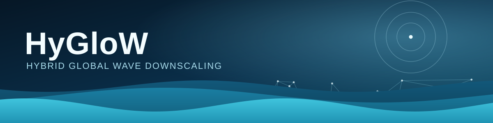

<p align="center">
  
</p>

<p align="center">
  
  
  
  <a href="LICENSE"></a>
</p>

HyGloW turns an offshore wave hindcast into nearshore wave conditions —
buoys, tide gauges, any point you care about — without running a full
spectral wave model at every timestep. For your region, a small number of
physics-based **SnapWave** runs train a statistical **metamodel** that then
reconstructs the whole time series (bulk parameters or full spectra) cheaply.

If you have an area of interest, a bathymetry source, and an offshore wave
hindcast, you can have nearshore wave conditions there. That's what this
repo helps you do.

## What this repository is

HyGloW is under active development. This repo is the **base code for the
whole HyGloW ecosystem** — the engine, the case contract, and the results
portal (`GUI/`) all live here, and every regional use case is built from it.
There are two ways to use it:

- **Just want nearshore waves for your region?** Fork or clone this repo,
  run `hywaves start`, and work in your own case folder from there —
  Quickstart below. Once scaffolded, a case is self-contained: you don't
  need to keep up with this repo unless you want engine improvements later
  (`hywaves update`).
- **Want to help build the toolkit itself** — the engine, the GUI, the case
  contract? Fork it and open a PR against `hywaves/` or `GUI/`, same as any
  open-source project.

Expect rough edges while this is young. Issues and PRs are welcome either way.

## Quickstart

**0. Install dependencies** (once):

- A conda/Python environment with `bluemath_tk`, `bluemesh2d`, `wavespectra`,
  `xarray`,`geopandas`, `rioxarray`, `pandas`, `scipy`, `matplotlib`.
  You can install all with `conda install -c conda-forge bluemath-tk`.
- [**SnapWave**](https://github.com/danoroelvink/snapwave/) — the nearshore
  propagation model. It's an external binary: clone that repo and compile it
  yourself (see its own README for build instructions). You'll need it
  before the notebooks that actually run cases (step 05 onward below).

**1. Create your case:**

```bash
python -m hywaves start --name MyCase
cd MyCase
```

This gives you a self-contained folder: engine code, numbered notebooks,
and a config skeleton. Nothing is downloaded for you — you fill in your
region's data as you go.

**2. Open `MyCase/README.md`** and work through the numbered notebooks in
order — that README is your main guide from here on, with the full
notebook-by-notebook walkthrough.

**3. Check your progress anytime:**

```bash
python -m hywaves validate MyCase/            # development mode: gaps are warnings
python -m hywaves validate MyCase/ --publish  # strict: is this ready to share?
```

## Want to see a finished example first?

| Case                                     | Region               | Status                                                                                          |
| ---------------------------------------- | -------------------- | ----------------------------------------------------------------------------------------------- |
| [Samoa](Samoa/README.md)                 | Samoan archipelago   | Full pipeline: mesh → LHS → metamodel fit → offshore hindcast → buoy/spectra validation         |
| [NewSouthWales](NewSouthWales/README.md) | NSW coast, Australia | Mesh, 26 goals, and a 35-buoy observations catalogue done; metamodel fit and validation pending |

Or browse every published case in the results portal:

```bash
cd GUI && python app.py   # http://localhost:8050
```

## The pipeline, in one paragraph

For a region, the numbered notebooks walk through: clipping bathymetry to an
area of interest → building an unstructured mesh → cataloguing nearshore wave
observations (buoys, tide gauges, ...) → choosing offshore "goal" points and
their propagation sectors → sampling each sector with a Latin Hypercube
design and running SnapWave once per sample (the **metamodel** training set)
→ fitting an MDA → PCA → GP emulator per goal → downloading an offshore
hindcast and running SnapWave once per hindcast timestep (the **dynamic**
reference run) → validating the metamodel against that dynamic run and
against real buoy records.

## Repository layout

| Path             | What it is                                                                             |
| ---------------- | -------------------------------------------------------------------------------------- |
| `hywaves/`        | The engine, contract, and CLI (`python -m hywaves ...`) — scaffolds and validates cases |
| `Samoa/`         | Reference case — Samoan archipelago                                                    |
| `NewSouthWales/` | Reference case — NSW coast, Australia                                                  |
| `GUI/`           | *HyGloW Results Explorer* — a Dash portal that reads any case's contract files         |

Full CLI reference (including `update`, which re-syncs a case's engine code
from the template): [`hywaves/README.md`](hywaves/README.md).

## Contributing a case back

A **case** is a self-contained folder for one region — its own area of
interest, mesh, goal points, observations catalogue, and results. Cases can
live in this repository or in your own repo; what makes a folder a HyGloW
case is conformance to the [case contract](hywaves/contract/CONTRACT.md).

1. `python -m hywaves start --name YourCase`
2. Fill in `YourCase/YourCase.json` and work through the numbered notebooks.
3. `python -m hywaves validate YourCase/ --publish`
4. Open a PR here (using your fork), or host it in your own repo and point the GUI catalog
   (`GUI/catalog/cases.yaml`) at it — the contract is the only thing that
   needs to match.

Engine code (`utils/`) is **vendored** into every case so each one runs
standalone. If you fix a bug in your case's copy, please also land it in
[`hywaves/template/`](hywaves/template/) so `python -m hywaves update` can carry
the fix to every other case.

---

## Authors

Built by the [**GeoOcean**](https://github.com/GeoOcean) research group
(Universidad de Cantabria). Questions, doubts, or just want to say hi?
Reach out to Javier Tausía ([@tausiaj](https://github.com/tausiaj),
[tausiaj@unican.es](mailto:tausiaj@unican.es)).

Licensed under [GPLv3](LICENSE).
